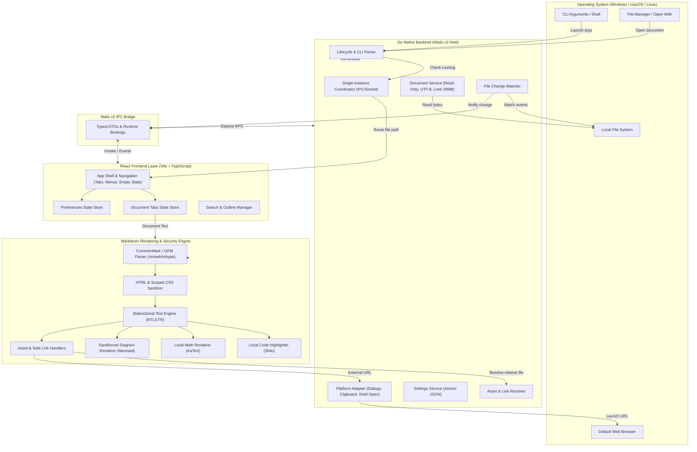

# System Architecture Overview

## 1. System Vision and Architectural Invariants

Lumark is a dedicated, local-first, read-only desktop application for viewing Markdown files. The architecture is guided by six primary invariants established in [PRD.md](../../PRD.md):

1. **Viewer First:** The application does not edit, mutate, or write back to user documents. It is purely an offline viewing engine.
2. **Local-First & Offline:** Rendering documents, KaTeX formulas, Mermaid diagrams, and code highlighting requires zero internet connectivity and zero external runtime processes.
3. **Safe by Default:** Documents are treated as untrusted input. The native bridge and OS file system are never directly exposed to document content.
4. **Bidirectional (RTL/LTR) as Core:** Multilingual and mixed-direction documents (Persian/Arabic with English) are first-class citizens with block-level auto-detection, explicit `dir` markup, and scoped CSS direction.
5. **Native Desktop Integration:** OS file associations, command-line arguments, single-instance routing, multi-document tabs, and native window behaviors operate seamlessly across Windows, macOS, and Linux.
6. **Separation of Concerns:** Native desktop capabilities, document models, preferences, and rendering engines reside behind strictly bounded interfaces.

---

## 2. High-Level Component Architecture

---

## 3. Technology Stack Reference

- **Host Language:** Go (compatible stable release).
- **Desktop Shell:** Wails (evaluating Wails v3 `v3.0.0-beta.34` candidate with Wails v2 `v2.17.0` fallback in [ADR-0001](../decisions/ADR-0001-technology-baseline.md)).
- **Frontend Stack:** React, TypeScript (strict mode), Vite, Vanilla CSS.

- **Markdown & Dialect:** `react-markdown`, `remark-gfm`.
- **Formulas:** `remark-math`, `rehype-katex` with bundled KaTeX fonts and styles.
- **Diagrams:** Locally bundled Mermaid with strict scriptless configuration.
- **Code Syntax:** Local Shiki syntax highlighter with pre-bundled themes.
- **Sanitization:** `rehype-sanitize` + PostCSS AST parser for scoped document styles.
- **Persistence:** Atomic JSON settings file in OS user-config directory.

---

## 4. Key Architectural Trade-Offs & Decisions

- **System WebViews vs Bundled Chromium:** Using Wails leverages platform WebViews (WebView2 on Windows, WebKit on macOS, WebKitGTK on Linux), reducing installer size to ~15-25MB compared to Electron's 150+MB. To mitigate engine rendering differences, an extensive golden fixture suite is tested on each OS.
- **Inert DOM vs Direct File Navigation:** The WebView never navigates directly to `file://` URLs. Instead, the Go backend reads file bytes, validates boundaries, and sends content to the frontend where it is safely rendered as inert DOM.
- **Read-Only Document Access:** The application contains zero save, overwrite, or in-place edit mechanisms in the MVP, ensuring document integrity.
