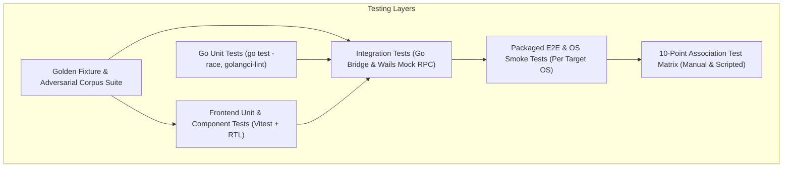

# Quality & Verification Strategy

## 1. Testing Philosophy and Invariants

Testing is not an afterthought or an optional release activity in this project:
1. **No Code Without Verification:** A Story or Task is never complete merely because source code compiles. Observable, reproducible test execution evidence is mandatory.
2. **Platform Parity & Evidence Discipline:** A green test run on Linux does not validate macOS or Windows behavior. Platform-specific behaviors (file associations, single-instance IPC, WebViews, fonts) must be verified on their respective OS environments.
3. **Strict Treatment of Unavailable Environments:** Any test that cannot be executed due to the host environment (e.g., Windows registry testing on Linux, or macOS packaging on WSL2) must be recorded as **`NOT RUN`** or **`BLOCKED`**. Agents must never fabricate results or infer cross-platform success from a single platform.
4. **Adversarial Security First:** Untrusted input is the norm. We maintain a dedicated corpus of adversarial Markdown, HTML, SVG, and CSS payloads to verify that malicious input is reliably neutralized.

---

## 2. Test Pyramid and Layers

---

## 3. Testing Layers & Automation vs Manual Breakdown

### 3.1 Go Backend Unit Tests (`internal/...`) — Automated
Tooling: `go test -v -race`, `go vet`, `golangci-lint`, `govulncheck`.
- **Path & Extension Validation:** Verify `.md`, `.markdown`, `.mdown`, `.mkd` acceptances, case-sensitivity on Linux, and rejection of disallowed extensions.
- **Document Loading & Boundary Checks:** Verify file size limit (20 MiB rejection), BOM handling (UTF-8, UTF-16 warning/fallback), replacement character insertion for corrupted bytes.
- **Settings & Persistence:** Atomic file writes, schema migration from v0 to v1, recovery from corrupted JSON settings, validation of bounds (zoom limits, recents max count).
- **Recent Files Management:** Bounded to 20, deduplication of paths, missing file detection.
- **Single-Instance IPC:** Socket/pipe creation, client connection, payload serialization, stale socket recovery.
- **URL Scheme Validation:** Strict allowlist of `http:`, `https:`, `mailto:`; rejection of `file:`, `javascript:`, `data:`, `vbscript:`.

### 3.2 Frontend Unit & Component Tests (`frontend/src/...`) — Automated
Tooling: `Vitest`, `@testing-library/react`, `jsdom`.
- **Markdown Parsing Pipeline:** CommonMark block/inline parsing, GFM tables, strikethrough, autolinks, task lists.
- **Custom Renderers:**
  - Code Blocks: Shiki highlighting, line counts, copy-to-clipboard button (preserving spaces/newlines/Unicode).
  - KaTeX: Valid LaTeX rendering, malformed LaTeX error fallback without crashing.
  - Mermaid: Safe rendering, strict config (no click handlers), error message fallback with raw source.
- **Bidirectional Text Engine:**
  - First strong character detection (`dir="auto"`).
  - Explicit HTML `dir="rtl|ltr"` preservation.
  - Scoped CSS direction precedence.
  - LTR enforcement on code blocks, formulas, and diagrams.
- **Navigation & Search:**
  - Heading outline generation, slug uniqueness for identical heading titles.
  - Search query matching, case-insensitivity, match counting, next/previous active match cycling.
- **Tab State Management:**
  - Tab opening, closing, switching, duplicate prevention (focus existing tab).

### 3.3 Security & Sanitization Test Corpus (`fixtures/security/`) — Automated
Tested against the rendering pipeline:
- `<script>` tags, inline scripts, nested `<script>` tags.
- Event handlers (``, `
`, etc.).
- Protocol attacks: `javascript:alert(1)`, `data:text/html,...`, whitespace obfuscated protocols (`java script:`).
- SVG attacks: Embedded `<script>` in SVG, event handlers, external references.
- CSS attacks: `@import url(...)`, external `@font-face`, `position: fixed` full-screen overlays, selectors targeting `.tab-bar` or `#app-root`.
- Malicious Mermaid: `click` directives, SVG script injections.
- DoS attacks: Deeply nested lists (100+ levels), 50,000-character single lines.

### 3.4 Golden Document Fixtures (`fixtures/golden/`) — Automated
Version-controlled Markdown files used for regression testing:
1. `commonmark-spec.md` — Standard CommonMark constructs.
2. `gfm-extensions.md` — Tables, task lists, strikethrough, autolinks.
3. `persian-prose.md` — Pure Persian text, RTL alignment, joined characters.
4. `arabic-prose.md` — Pure Arabic text, RTL alignment.
5. `mixed-bidi-tech.md` — Persian paragraphs with English headings, inline code, and URLs.
6. `explicit-dir-styling.md` — Author `dir="rtl"` and scoped CSS classes.
7. `math-katex.md` — Inline `$x^2$` and display `$$\int f(x)dx$$` formulas.
8. `diagrams-mermaid.md` — Flowcharts, sequence, class, state, ER, and Gantt charts.
9. `code-syntax.md` — Multi-language code fences (Go, TypeScript, Python, Rust, SQL, Markdown).
10. `local-assets.md` — Relative images, local Markdown cross-links, missing asset fallbacks.

### 3.5 OS Integration & Association Procedures — Explicit Manual & Scripted
Where automated end-to-end execution cannot reliably simulate OS shell interactions:
1. **Fresh Install & Launch:** App launches into interactive empty state within 2.5s.
2. **File Association Open (Manual):** Double-clicking `.md` in OS file manager (Nautilus, Explorer, Finder) launches app and renders content.
3. **Open With Candidate (Manual):** Right-clicking `.md` confirms app appears in Open With list.
4. **CLI Arguments (Automated/Scripted):** `./markdown-viewer sample.md` opens specified file.
5. **Single-Instance Forwarding (Scripted):** Secondary launch sends path to running instance.
6. **Offline Verification (Scripted):** App operates with network disabled.
7. **Clean Uninstall & Registry/MIME Cleanup (Manual/Scripted):** Uninstallation verified to remove desktop entries and associations without orphaned files or document data loss.

---

## 4. Continuous Integration Pipeline (GitHub Actions)

On every Pull Request and Tag:
- **Lint & Format:** `golangci-lint run`, `goimports -l .`, `shellcheck scripts/*.sh`, `shfmt -d scripts/*.sh`, `npm run lint`.
- **Unit & Security Tests:** `go test -v -race ./...`, `npm run test:unit`, `govulncheck ./...`, `npm audit`.
- **Cross-Platform Matrix Builds:**
  - `ubuntu-24.04` (Linux x64 `.deb`)
  - `windows-latest` (Windows x64 NSIS installer)
  - `macos-latest` (macOS Apple Silicon `.app` / `.dmg`)
