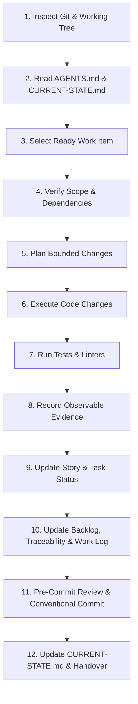

# Implementation Protocol for AI Coding Agents

## 1. Overview and Mandatory Lifecycle

This protocol defines the strict **12-Step Execution Lifecycle** that every AI agent must follow when contributing to `markdown-go`.

Adherence to this lifecycle ensures that:
- Work is bounded, incremental, and completely documented.
- No session memory or ephemeral conversation state is needed to resume work.
- Incomplete work or blockers are captured transparently.
- Verification evidence is authentic and recorded in the repository.

---

## 2. The 12-Step Execution Lifecycle



### Step 1: Inspect Git & Working Tree
- Run `git status --short` and `git diff` to understand current file states.
- If uncommitted changes exist from a previous interrupted agent or user, **preserve them**. Do not discard, overwrite, reset, or commit unrelated work without explicit instructions.

### Step 2: Read Guidelines & Current State
- Read [AGENTS.md](../../AGENTS.md).
- Read [docs/implementation/CURRENT-STATE.md](CURRENT-STATE.md).
- Identify the active overall phase, active work item, blockers, and required next action.

### Step 3: Select a Ready Work Item
- Check `docs/implementation/CURRENT-STATE.md` for the assigned work item.
- If choosing the next item from [docs/implementation/BACKLOG.md](BACKLOG.md), pick the first item whose status is `READY` and whose dependencies are completely satisfied.
- Transition the Story and Task status to `IN_PROGRESS`.

### Step 4: Verify Scope & Dependencies
- Read the active User Story file (`docs/stories/US-XXX-*.md`) and parent Epic (`docs/epics/EPIC-XXX-*.md`).
- Read the Task's completion criteria, dependencies, verification procedures, and evidence requirements.
- Review the source PRD requirements, dependencies, and explicit out-of-scope exclusions.
- If an undeclared blocker or missing dependency is found, transition status to `BLOCKED` in the Story, record the reason in `CURRENT-STATE.md`, and stop.

### Step 5: Plan the Bounded Changes
- Identify the exact files to be created or modified.
- Verify architectural alignment with `docs/architecture/` and decisions in `docs/decisions/`.
- Never execute changes across unrelated modules in the same work session.

### Step 6: Execute Bounded Implementation
- Implement only the agreed logic defined in the active Task.
- Preserve existing comments, docstrings, and formatting.
- Follow technology choices established in [ADR-0001](../decisions/ADR-0001-technology-baseline.md) (evaluating Wails v3 candidate vs Wails v2 fallback + React + TypeScript + Vite).

### Step 7: Run Verification Commands & Linters
- Run the designated tests, build commands, or linters for the modified components adhering to the Agent Tooling Policy in `AGENTS.md`.
- Backend: `golangci-lint run`, `goimports -l .`, `go test -v -race ./...`, `govulncheck ./...`.
- Frontend: `npm run lint`, `npm run test:unit`, `npm run build`.
- Shell: `shellcheck scripts/*.sh`, `shfmt -d scripts/*.sh`.

### Step 8: Record Observable Evidence & Platform Distinction
- Capture actual terminal output, exit codes, and test summaries.
- Insert the evidence into the Story file under the `Validation Evidence` section.
- **Platform Separation Rule:** Distinguish build, automated test, packaging, and interactive runtime evidence. Maintain separate records for Windows, Linux (WSL2/WSLg vs native), and macOS. Mark unexecuted checks as `NOT RUN` or `BLOCKED`. Never invent or infer results.

### Step 9: Update Story & Task Documents
- Confirm that every completion criterion in the Task has corresponding verification evidence.
- Review the diff for correctness, scope, regressions, secrets, accidental files, and consistency with architecture and `PRD.md`.
- Distinguish an agent self-review from an independent review; never describe a self-review as an independent review.
- Update individual Task checkboxes and statuses from `IN_PROGRESS` to `DONE` only when all required completion and verification conditions have actually passed. If a check fails, is blocked, or has not run, record the precise result (`FAIL`, `NOT RUN`, `BLOCKED`) and keep the blocker visible.
- If all Tasks in a Story are verified `DONE`, update the Story status to `DONE`.

### Step 10: Update Backlog, Traceability & Work Log
- Update the item status in [docs/implementation/BACKLOG.md](BACKLOG.md).
- Update verification status in [docs/implementation/REQUIREMENT-TRACEABILITY.md](REQUIREMENT-TRACEABILITY.md) if requirement status changed.
- Append a new entry to [docs/implementation/WORK-LOG.md](WORK-LOG.md) describing the work done, files changed, and test results.

### Step 11: Pre-Commit Review & Task-Level Conventional Commit
- Execute the pre-commit review:
  - Run `git diff --check` to verify no whitespace errors.
  - Inspect `git status --short`.
  - Review staged changes with `git diff --cached`.
  - Stage **explicit file paths** only (never `git add -A` or `git add .`).
  - Preserve any unrelated or pre-existing user changes.
- Commit the completed Task using Conventional Commits: `<type>(<scope>): <imperative summary>`.
- Include the Task ID and actual verification summary in the commit body.

### Step 12: Update CURRENT-STATE.md & Handover (or Interruption Recovery)
- Update [docs/implementation/CURRENT-STATE.md](CURRENT-STATE.md) with:
  - Last completed and verified work item and commit hash.
  - Active or next work-item ID.
  - Any newly uncovered blockers or decisions.
  - Required reading list for the next incoming agent.
- **Preserving Partial Work on Interruption:** If an agent hits context-window limits, session timeout, or encounters an unexpected failure before a Task is complete:
  - Leave uncommitted work in the tree.
  - In `CURRENT-STATE.md`, mark the active Task as `IN_PROGRESS` or `BLOCKED`.
  - Clearly write down what was completed, what failed, and the exact next command the next agent must run.

---

## 3. Task-Level Conventional Commits Lifecycle & Policy

### 3.1 Task as the Default Unit of Commit
The default unit of commit in this repository is **one completed Task per commit**.
- Never batch multiple unrelated Tasks into a single commit.
- Never commit partial, non-compiling, or unverified work under a `feat` or `fix` type unless explicitly structured as an intentional checkpoint commit (e.g. `chore(checkpoint): ...`).
- Every completed Task commit represents an atomically verified increment with documented evidence.

### 3.2 Pre-Flight Protocol (Before Starting a Task)
1. Run `git status --short` and `git diff` to inspect the working tree.
2. If uncommitted changes exist from unrelated user work or interrupted sessions, preserve them. Do not discard, overwrite, reset, or commit them.
3. Read the target Task in `docs/stories/US-XXX-*.md` and parent Epic in `docs/epics/EPIC-XXX-*.md`.
4. Read the Task's completion criteria, dependencies, verification procedures, and evidence requirements.
5. Confirm all prerequisites are `DONE`. If a dependency is missing, mark the Task `BLOCKED` in `CURRENT-STATE.md` and do not begin implementation.
6. Synchronize the Task status to `IN_PROGRESS`.

### 3.3 Implementation & Verification Discipline (Before Completing a Task)
1. **Bounded Scope:** Implement only the agreed Task scope. Do not perform speculative feature additions or unsolicited refactoring across unrelated packages.
2. **Execute Verification Commands:** Run the specific verification commands, unit tests, and build scripts defined in the Task.
3. **Run Linters and Security Checks:** Run relevant static analysis (`golangci-lint`, `goimports`, `govulncheck`, `shellcheck`, `npm run lint`) required by the Task.
4. **Inspect Diff & Quality:** Review the diff for correctness, scope adherence, potential regressions, secret exposure, and architectural consistency with `PRD.md`.
5. **Record Authentic Evidence:** Record actual terminal output, pass counts, and exit codes in the Story's `Validation Evidence` section.
6. **Update Tracking State:** Update Task status, Story summaries, `BACKLOG.md`, `CURRENT-STATE.md`, and append an entry to `WORK-LOG.md`.
7. **Accurate Status Marking:** Mark the Task `DONE` only when all completion criteria have matching verification evidence. If a check cannot run or fails, mark `NOT RUN`, `BLOCKED`, or `FAIL`. Never claim completion for unexecuted checks.
8. **Self-Review Discipline:** Distinguish a review conducted by another agent or human reviewer from an agent self-review. Never misrepresent a self-review as an independent review.

### 3.4 Pre-Commit Staging & Execution Protocol
Before executing any commit:
1. **Whitespace and Format Check:** Run `git diff --check` to ensure no whitespace errors, trailing spaces, or conflict markers exist.
2. **Status Inspection:** Inspect `git status --short` to see all modified and untracked files.
3. **Explicit Staging:** Stage only explicit file paths relevant to the completed Task using:
   ```bash
   git add <explicit-file-1> <explicit-file-2> ...
   ```
   **Strict Prohibition:** NEVER run `git add -A` or `git add .` to blindly stage the repository tree.
4. **Diff Review:** Inspect the staged diff using:
   ```bash
   git diff --cached
   ```
   Verify that no accidental files, temporary scratch scripts, secrets, or unrelated changes are staged.
5. **Commit Execution:** Execute the commit adhering to Conventional Commits without bypassing commit hooks. Never amend published commits or rewrite history without explicit user instruction.

### 3.5 Conventional Commits Schema & Formatting Standards
Use the Conventional Commits specification:
```text
<type>(<scope>): <imperative summary>

[optional body with Task ID and verification evidence summary]

[optional footer(s)]
```

#### Permitted Commit Types:
| Type | Purpose | Example |
|---|---|---|
| `feat` | New feature or functional capability | `feat(file-open): support CLI file arguments` |
| `fix` | Bug fix or defect remediation | `fix(render): preserve output after sanitizer failures` |
| `refactor` | Code restructuring without feature or bug changes | `refactor(parser): extract AST node transformation logic` |
| `test` | Adding or updating tests without production code changes | `test(security): add malformed HTML regression cases` |
| `docs` | Documentation updates, architecture, or planning additions | `docs(planning): record feasibility spike results` |
| `build` | Build toolchain, compiler flags, Taskfile, or package config | `build(wails): configure Linux WebKitGTK packaging flags` |
| `ci` | CI workflow scripts, GitHub Actions, or runner setup | `ci(workflows): add multi-platform test runner matrix` |
| `perf` | Performance improvement with measured evidence | `perf(tokenizer): optimize large document chunking` |
| `security` | Security policy, allowlist rules, or sanitizer hardening | `security(sanitizer): restrict CSS url() scheme handling` |
| `chore` | Maintenance, repository tooling, or audit remediation | `chore(planning): finalize audit remediation and validation tooling` |

#### Commit Message Format Example:
```text
feat(file-open): support CLI file arguments

Task: US-002.1
- Implemented CLI argument parser in backend app service.
- Supported single and multiple Markdown file paths on launch.
- Handled non-existent files with safe error dialog dispatch.

Verification:
- go test -v -race ./pkg/cli/... (PASS, 6/6 tests)
- golangci-lint run ./pkg/cli/... (PASS)
```

### 3.6 Environment-Blocked Tasks & Non-Fabrication Protocol
When a Task cannot be completed because a required target platform (e.g. native Windows host tools, macOS hardware, native Linux desktop manager) is unavailable in the execution environment:
1. Do not mark the Task `DONE`.
2. Record the verification status as `NOT RUN` or `BLOCKED` with the explicit platform limitation documented in the Story's `Validation Evidence`.
3. Do not create a completed feature commit claiming full platform verification.
4. If code changes were made that compile and pass in the available environment (e.g. WSL2/WSLg), commit the scoped change with an accurate Conventional Commit (e.g., `feat(platform): implement Windows association registry keys (unverified on native host)`), and document the pending verification gate in `CURRENT-STATE.md`.
5. Never fabricate test outputs, exit codes, or interactive evidence.

### 3.7 Story Completion & Integration Commits
When all Tasks in a Story have been implemented and individually committed:
1. **Story Integration Verification:** Run the Story-level integration, end-to-end, and regression checks specified in the Story document.
2. **Review Acceptance Criteria:** Verify that every Story acceptance criterion is fully substantiated by actual verification evidence.
3. **Synchronize Statuses:** Transition Story status to `DONE` in the Story file, `docs/implementation/BACKLOG.md`, `docs/implementation/CURRENT-STATE.md`, and log the milestone in `docs/implementation/WORK-LOG.md`.
4. **No Redundant Story Commits:** If all changes are already captured in the individual Task commits and no new files or modifications were produced by the Story-level checks, **do not create an empty or duplicate Story commit**.
5. **Distinct Integration Commits:** If the Story integration check uncovers an integration defect requiring a code or documentation fix:
   - Make the targeted fix.
   - Commit the fix separately using Conventional Commits referencing the Story and affected Task (e.g., `fix(tabs): resolve active tab highlight during multi-file open`).

---

## 4. Work-Item Status Transitions

```text
       [DRAFT]
          │
          ▼
       [READY] ◄────────┐
          │             │
          ▼             │
    [IN_PROGRESS] ──► [BLOCKED]
          │
          ▼
        [DONE]
```

- `DRAFT`: Initial specification; incomplete acceptance criteria or unreviewed tasks.
- `READY`: Fully specified, all dependencies satisfied, ready to be picked up.
- `IN_PROGRESS`: Actively under execution by an agent.
- `BLOCKED`: Blocked by external dependency, platform limitation, or failed verification.
- `DONE`: Code implemented, tests passed, observable evidence recorded in repo.
- `DEFERRED`: Formally postponed to a post-MVP phase.

---

## 5. Documentation is Part of Task Completion

Documentation updates are **mandatory completion criteria**, not optional cleanup tasks. An implementation task is not complete until:
1. Verification evidence is written in the Story.
2. `WORK-LOG.md` has been appended.
3. `CURRENT-STATE.md` has been updated.
4. `BACKLOG.md` has been updated.
