# Implementation Roadmap

The implementation is structured into seven sequential phases designed to de-risk technical feasibility and platform assumptions early before undertaking extensive UI and rendering work.

```mermaid
gantt
    title Implementation Phase Sequence
    dateFormat  X
    axisFormat %s

    section Planning
    Phase 0 - Planning & Governance Baseline :milestone, m0, 0, 0
    section Feasibility
    Phase 1 - Technical Feasibility Spike     :active, p1, 1, 3
    section Core Infrastructure
    Phase 2 - Native Lifecycle & Tabs         :p2, 4, 6
    section Rendering Pipeline
    Phase 3 - CommonMark & Core Rendering     :p3, 7, 9
    section Advanced Features & Security
    Phase 4 - Advanced Rendering, Bidi & Security :p4, 10, 13
    section Durability & UX
    Phase 5 - Reading Experience & Durability :p5, 14, 16
    section Release Hardening
    Phase 6 - Packaging & OS Integration      :p6, 17, 20
```

---

### PRD Suggested Phases to Implementation Roadmap Crosswalk (AUD-016)

PRD Section 14 suggests 10 conceptual phases (Phase 0 through Phase 9). The implementation roadmap organizes these into 7 execution phases to de-risk platform assumptions early and optimize architectural sequencing:

| PRD §14 Suggested Phase | Implementation Roadmap Phase | Consolidation & Sequencing Rationale |
|---|---|---|
| **Phase 0:** Project setup & architecture decisions | **Phase 0:** Planning & Governance Baseline | Pure planning baseline with zero code; establishes agent contracts, canonical deliverables, and ADRs before implementation. |
| **Phase 1:** Minimal packaged application spike | **Phase 1:** Technical Feasibility Spike | Validates cross-platform packaging, IPC, and WebView runtime upfront on all 3 OS targets before product features. |
| **Phase 3:** Tabbed interface & document lifecycle | **Phase 2:** Native Lifecycle & Tabs | Core application shell, typed RPC bridge, and multi-document tab state are built first to provide the host container. |
| **Phase 2:** Local Markdown & CommonMark | **Phase 3:** CommonMark & Core Rendering | Core CommonMark/GFM pipeline, code blocks, headings, and local asset resolution integrated into the tab container. |
| **Phase 4:** Full rendering pipeline & **Phase 5:** Bidirectional text & RTL | **Phase 4:** Advanced Rendering, Bidi & Security | Groups all complex AST transformations (KaTeX, Mermaid, HTML/CSS sanitization, and RTL/LTR bidi engines) into one milestone. |
| **Phase 6:** Search, TOC, navigation & **Phase 7:** Settings & print | **Phase 5:** Reading Experience & Durability | Combines user reading tools (TOC, search, zoom, theme, print) with persistence (settings, recent files, disk watcher, diagnostics). |
| **Phase 8:** Packaging hardening & **Phase 9:** Pre-release verification | **Phase 6:** Packaging & OS Integration | Unifies final OS package builds (NSIS, DMG, DEB), 10-point association matrix execution, benchmarks, and release checklist. |

---

## Phase 0: Repository, Planning & Decision Baseline

- **Objective:** Establish a durable, file-based pair-programming workflow, decompose `PRD.md` into traceable Epics, Stories, and Tasks, establish architectural baselines, and complete pre-implementation planning revalidation.
- **Entry Criteria:** `PRD.md` committed as product source of truth.
- **Deliverables:**
  - `AGENTS.md` (universal operating instructions, tooling policy, and platform evidence rules).
  - Canonical PRD deliverables (`docs/markdown-support.md`, `docs/security.md`, `docs/testing.md`, `docs/packaging.md`).
  - Architecture specifications (`OVERVIEW.md`, `MODULE-BOUNDARIES.md`, `TEST-STRATEGY.md`, `PLATFORM-SUPPORT.md`, `DEVELOPMENT-TOOLING.md`).
  - Architecture Decision Records (`ADR-0001` with Wails v3 candidate vs v2 fallback, `ADR-0002`, `ADR-0003`).
  - Implementation backlog with 8 Epics and 32 User Stories.
  - Requirement Traceability Matrix with 60 categorized requirements and obligations.
  - Planning Validation report and Independent Planning Audit Remediation report.
- **Exit Criteria:**
  - All planning documents internally consistent, using portable relative links.
  - Development tooling policy and platform verification matrices explicitly documented.
  - Support matrix confirmed for Windows 10/11 x64, macOS Apple Silicon, and Ubuntu 24.04 LTS x64.
  - *PRD Phase 0 / Phase 1 Boundary Note:* PRD Section 14 Phase 0 lists "a buildable minimal application and documented confirmed support matrix" as exit criteria, while Phase 1 Step 1 specifies "Generate a minimal Wails v2 React/TypeScript app". To maintain deterministic execution without pre-empting feasibility spike controls, Phase 0 is defined as the planning and decision baseline (with zero application code or npm dependencies committed). The buildable minimal application is delivered in Phase 1 (`US-001`).
- **Status:** **REMEDIATION COMPLETE (PLANNING READY / EXECUTION VERDICT: NOT_READY PENDING BASELINE DECISION & PLATFORM EVIDENCE)**

---

## Phase 1: Packaged Application Feasibility Spike

- **Objective:** Build a disposable minimal application with Go + Wails (evaluating Wails v3 `v3.0.0-beta.34` candidate with Wails v2 `v2.17.0` fallback) + React + TypeScript + Vite to validate core platform, WebView, IPC, and packaging assumptions before beginning full UI or rendering implementation.
- **Scope (EPIC-001):**
  - Verify embedded production frontend assets (zero runtime dev server, zero Node.js runtime on user machines).
  - Verify single-instance IPC coordination and file path forwarding (evaluating native v3 single-instance vs custom socket v2 fallback).
  - Verify local image asset resolution and WebView rendering security sandbox.
  - Prototype file association in platform package formats (Windows NSIS `.exe`, Linux `.deb`, macOS `.app`).
- **Entry Criteria:** Phase 0 planning audit remediation complete and approved.
- **Exit Criteria (Strict PRD §14 Compliance — No Silent Weakening):**
  - **Mandatory Platform Gate:** Each declared target OS (**Windows 10/11 x64**, **macOS Apple Silicon**, **Ubuntu 24.04 LTS x64**) can install, launch, and open one associated Markdown file.
  - A file path opened from the command line or file manager renders in the WebView.
  - A secondary launch delivers the path to the existing instance without opening a duplicate window.
  - Objective pass/fail evaluation of Wails v3 candidate recorded in `ADR-0001`, confirming either adoption of Wails v3 or fallback to Wails v2.
  - *Platform Limitation Rule:* If a platform cannot be verified in the local development environment (e.g., Windows host tools missing or macOS hardware unavailable), that platform's gate must be recorded as `NOT RUN` or `BLOCKED`. Phase 1 cannot be marked complete without authorized CI/environment validation or an explicit product-owner scope change.
- **Major Risks:**
  - Wails v3 prerelease regressions or missing Linux GTK4/WebKitGTK 6.0 libraries on Ubuntu 24.04/26.04.
  - Local environment limitations (WSL2 with WSLg does not replace native Ubuntu desktop testing; Windows host tools unavailable).
  - Single-instance IPC race conditions across operating systems.

---

## Phase 2: Core Native Application Lifecycle & Tab Management

- **Objective:** Establish the foundational Go native services, typed RPC bridge, command-line routing, and React application shell with multi-document tabs.
- **Scope (EPIC-002):**
  - Go DocumentService (read-only, UTF-8 normalization, 20 MiB size limit).
  - Application lifecycle, CLI argument parsing, and production single-instance routing.
  - React application shell, empty state, drag-and-drop zone, and document tab strip.
  - Native file picker dialog integration.
- **Entry Criteria:** Phase 1 Feasibility Spike successfully validated across target platforms.
- **Exit Criteria:**
  - Opening multiple `.md` files via CLI, file picker, or drag-and-drop displays separate tabs.
  - Switching and closing tabs works smoothly.
  - Missing or inaccessible files display a clear, non-crashing error state.
- **Major Risks:**
  - Path normalization discrepancies between Windows backslashes and POSIX paths.

---

## Phase 3: CommonMark, GFM & Core Document Rendering

- **Objective:** Build the core Markdown rendering pipeline with GitHub Flavored Markdown extensions, local syntax highlighting, local asset resolution, and stable heading anchors.
- **Scope (EPIC-003):**
  - CommonMark + GFM parser pipeline (`react-markdown` + `remark-gfm`).
  - Local code block syntax highlighting (Shiki) with language badges and copy-to-clipboard.
  - Relative local image loading and safe local Markdown cross-links.
  - Safe external link handling (delegated to OS default browser).
  - Stable heading slug generation and baseline golden fixtures.
- **Entry Criteria:** Phase 2 complete and verified.
- **Exit Criteria:**
  - Standard CommonMark and GFM documents render accurately.
  - Code blocks can be highlighted and copied cleanly with preserved whitespace.
  - Relative images render without arbitrary filesystem exposure.
  - Core fixture suite passes in automated tests.
- **Major Risks:**
  - Large code blocks causing WebView layout freezes.

---

## Phase 4: Advanced Rendering, Bidirectional Layout & Security Sanitization

- **Objective:** Integrate formulas, diagrams, raw HTML/CSS sanitization, and full bidirectional text (RTL/LTR) support.
- **Scope (EPIC-004 & EPIC-005):**
  - Offline Mermaid diagrams rendering with strict security and error isolation.
  - Offline LaTeX math formulas (KaTeX) with bundled assets.
  - AST-based HTML sanitization (`rehype-sanitize`) and dedicated CSS parser for scoped styles.
  - Unicode block-level auto-direction (`dir="auto"`), explicit HTML `dir`, and CSS direction precedence.
  - LTR enforcement for code, math, and diagrams.
  - Comprehensive adversarial security corpus verification.
- **Entry Criteria:** Phase 3 complete and verified.
- **Exit Criteria:**
  - Mixed Persian/English documents render with correct per-paragraph direction.
  - Mermaid and KaTeX render completely offline.
  - Malformed diagrams/formulas degrade gracefully without breaking document view.
  - All adversarial XSS/script/CSS-escape fixtures are neutralized.
- **Major Risks:**
  - WebView bidirectional text shaping discrepancies across WebKitGTK and WebView2.
  - CSS injection escaping document boundaries if CSS AST parser is improperly configured.

---

## Phase 5: Reading Experience, Durability & Persistence

- **Objective:** Complete the user reading toolset, local persistence, file change monitoring, and error durability.
- **Scope (EPIC-006 & EPIC-007):**
  - Interactive Table of Contents sidebar with active heading tracking.
  - In-document text search with match counts and next/previous navigation.
  - Light, Dark, and System theme switching; zoom controls; native text selection & copy context menu (`FR-NAV-005`).
  - Native WebView print command and print CSS stylesheet.
  - Versioned atomic settings persistence (`settings.json`).
  - Bounded recent-files list and startup tab restoration.
  - Debounced file change watcher with scroll-position preservation.
  - Non-intrusive error toasts and bounded local diagnostics log.
- **Entry Criteria:** Phase 4 complete and verified.
- **Exit Criteria:**
  - Settings survive application restart and corrupted settings recover cleanly.
  - Modifying a file externally auto-reloads the view smoothly.
  - Search, TOC, zoom, and text selection work reliably via keyboard shortcuts and UI.
- **Major Risks:**
  - File watcher event storming on rapid file saves.

---

## Phase 6: Packaging, Operating-System Integration & Release Hardening

- **Objective:** Finalize OS-specific installers, file association registrations, CI build matrix, performance benchmarks, and release readiness.
- **Scope (EPIC-008):**
  - Windows NSIS installer with ProgID and Open With integration.
  - macOS `.app` bundle / `.dmg` with UTIs and Launch Services integration.
  - Linux Debian package (`.deb`) with `.desktop` and MIME database integration.
  - Execute 10-point association test matrix per target OS.
  - Performance benchmarking against PRD Section 12.1 targets.
  - Release acceptance checklist completion.
- **Entry Criteria:** Phase 5 complete and verified.
- **Exit Criteria:**
  - Clean install, association, upgrade, and uninstall verified on each target OS.
  - Launch-to-empty-state < 2.5s; 1 MiB render < 1.0s.
  - All P0 release criteria in PRD Section 15.1 signed off.
- **Major Risks:**
  - Windows `UserChoice` registry quirks or uninstaller leaving orphaned associations.
  - macOS code signing / Gatekeeper requirements.
