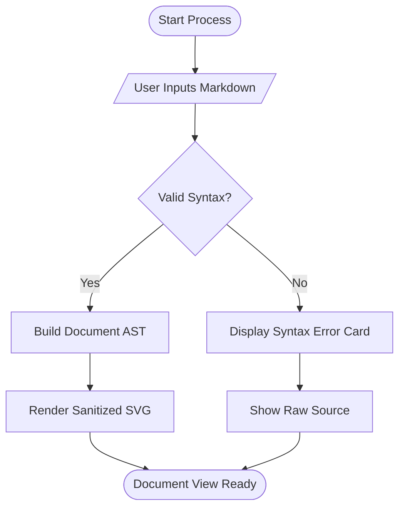
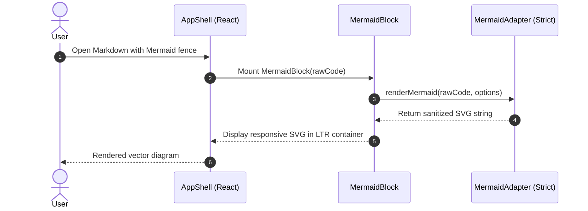
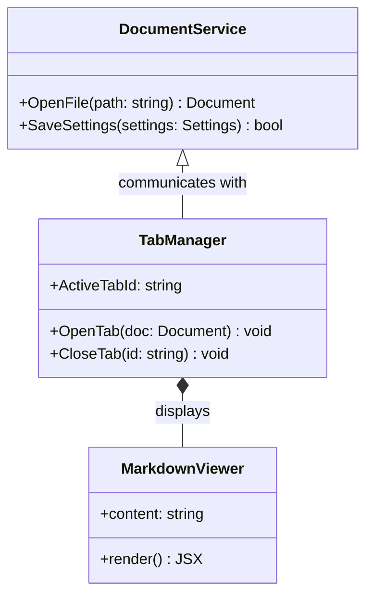
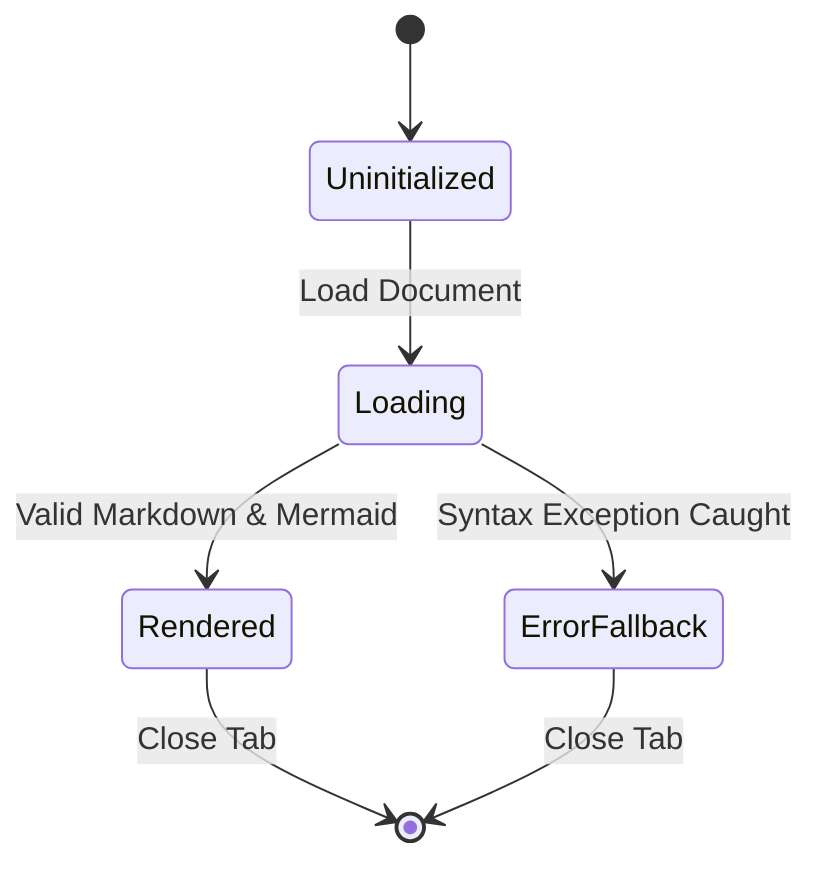
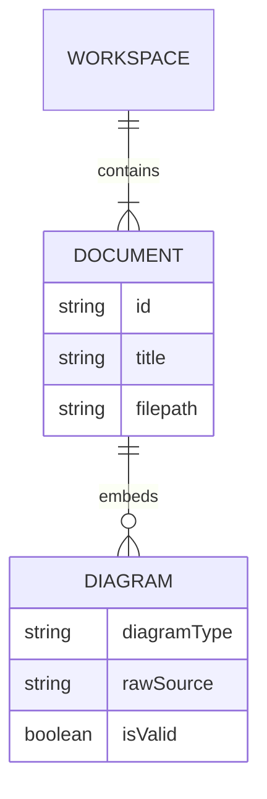
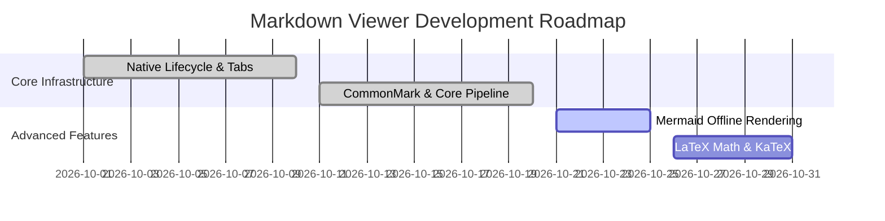

# Mermaid Diagrams Golden Fixture Suite

This document tests offline rendering of Mermaid diagrams across all core supported diagram types per FR-RENDER-005, FR-RENDER-009, and PRD Section 5.4.

## 1. Flowchart Diagram

## 2. Sequence Diagram

## 3. Class Diagram

## 4. State Diagram

## 5. Entity-Relationship (ER) Diagram

## 6. Gantt Chart

