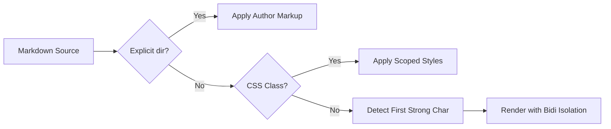

# مستندات فنی و راهنمای مهندسی معماری مختلط (Mixed-Direction Architecture)

این سند جامع به عنوان مرجع ارزیابی و آزمون رندرینگ اسناد فنی دوزبانه (فارسی و انگلیسی) طراحی شده است. اسناد فنی در دنیای واقعی همواره ترکیبی از پاراگراف‌های فارسی، قطعه‌کدهای انگلیسی، فرمول‌های ریاضی، دیاگرام‌های فلوچارت، آدرس‌های وب و شناسه‌های فنی هستند.

---

## ۱. یکپارچه‌سازی اصطلاحات فنی انگلیسی در متن فارسی

در توسعهٔ سیستم‌های توزیع‌شده، استفاده از کتابخانه‌های متن‌باز نظیر `React 18` و فریم‌ورک `Wails v3.0.0-beta.34` رایج است. برای نمونه، متغیر `GOTOOLCHAIN=auto` تنظیمات کامپایلر زبان `Go` را به صورت خودکار هدایت می‌کند.

هنگامی که یک عبارت انگلیسی نظیر `WebSocket connection closed` درون یک جملهٔ فارسی قرار می‌گیرد، علائم نگارشی نظیر ویرگول یا نقطه باید در انتهای منطقی جمله فارسی قرار گیرند، نه در محل اتصال دو زبان. این آزمون پایداری موتور بایدی را در مواجهه با نقاط مرزی ارزیابی می‌کند.

مسیرهای فایل مانند `/home/repos/personal/markdown-go` و آدرس‌های شبکه نظیر `http://127.0.0.1:8080/api/v1/health` باید به صورت چپ‌به‌راست نمایش یابند و ترکیب اعداد با ممیز و دونقطه دچار وارونگی نشود.

تاریخ‌های تقویمی نیز اهمیت بالایی دارند:
- تاریخ شمسی با ارقام فارسی: ۱۴۰۵/۰۸/۰۲
- تاریخ استاندارد با ارقام لاتین: 2026-10-25
- شماره نسخه نرم‌افزار: `v3.0.0-beta.34`

---

## ۲. عبارات ریاضی و فرمول‌های فنی (LaTeX / KaTeX)

فرمول‌های ریاضی درون پاراگراف‌های فارسی باید همواره ساختار چپ‌به‌راست و تراز مناسب خود را حفظ کنند.

فرمول انرژی نسبیتی $E = m c^2$ و رابطهٔ معروف فیثاغورس $a^2 + b^2 = c^2$ باید از چپ به راست خوانده شوند، در حالی که متن اطراف آن‌ها کاملاً راست‌به‌چپ است.

معادلهٔ انتگرال گاوسی زیر به عنوان معادلهٔ نمایشی مستقل (Display Math) باید بدون بهم‌ریختگی در جهت LTR رندر شود:

$$
\int_{-\infty}^{+\infty} e^{-x^2} \, dx = \sqrt{\pi}
$$

همچنین معادلهٔ ماتریسی با متغیرهای شاخص‌دار به صورت زیر است:

$$
\mathbf{A} \mathbf{x} = \lambda \mathbf{x}, \quad \text{where } \det(\mathbf{A} - \lambda \mathbf{I}) = 0
$$

---

## ۳. قطعه‌کدهای چندزبانه و برنامه‌نویسی سیستم

قطعه‌کد زیر به زبان Go پیاده‌سازی شده و نحوهٔ مدیریت اسناد و مسیرهای فایل را با رعایت انزوای کامل LTR نشان می‌دهد:

```go
package main

import (
	"fmt"
	"path/filepath"
)

// DocumentManager وظیفه بارگذاری امن اسناد را بر عهده دارد
type DocumentManager struct {
	BasePath string
	ReadOnly bool
}

func (dm *DocumentManager) ResolvePath(relPath string) (string, error) {
	// بررسی مسیر امن و عدم خروج از ریشه پروژه
	cleaned := filepath.Clean(filepath.Join(dm.BasePath, relPath))
	if cleaned == "" {
		return "", fmt.Errorf("مسیر نامعتبر است: %s", relPath)
	}
	return cleaned, nil
}
```

در این قطعه‌کد، تورفتگی تب‌ها، کامنت‌های دوزبانه، علائم عملگر (`:=`، `==`، `""`) و براکت‌ها باید کاملاً چپ‌چین و بدون جابجایی باقی بمانند.

همچنین یک اسکریپت کوتاه به زبان TypeScript برای اشتراک رویدادها:

```typescript
export interface DirectionConfig {
  defaultPreference: 'auto' | 'rtl' | 'ltr';
  enforceNonProseLTR: boolean;
}

export function evaluateDirection(text: string): 'rtl' | 'ltr' {
  const rtlRegex = /[\u0600-\u06FF\u0750-\u077F\u0590-\u05FF]/;
  return rtlRegex.test(text) ? 'rtl' : 'ltr';
}
```

---

## ۴. دیاگرام‌های ساختاری و معماری (Mermaid)

دیاگرام زیر فرآیند تشخیص جهت‌بندی سند را به صورت جریان چپ‌به‌راست ترسیم می‌کند، حتی زمانی که در دل یک سند فارسی جای گرفته است:



---

## ۵. پیوندها و مراجع بیرونی

برای مطالعهٔ مستندات کامل، می‌توانید به پایگاه رسمی [Wails Framework Documentation](https://v3.wails.io/) مراجعه کنید یا راهنمای [CommonMark Specification](https://spec.commonmark.org/) را بررسی فرمایید.
