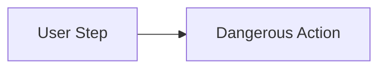
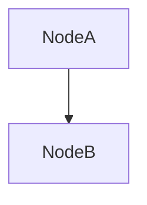
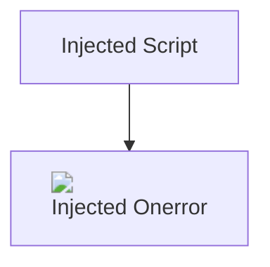

# Adversarial Security Fixture: Mermaid Script Injection & Directive Attacks

This fixture tests Mermaid diagram definition attacks, interactive callbacks, dangerous click URLs, and SVG payload smuggling per PRD Section 8.1, Section 8.3, and FR-RENDER-005.

## 1. Mermaid Click Directive with JavaScript Callback

```mermaid
graph TD
    A[Start Node] --> B[Exploit Node]
    click B callback "window.__malicious_executed = true;" "Click to trigger callback"
```

## 2. Mermaid Click Directive with JavaScript URI



## 3. Mermaid Click Directive with Data HTML URI



## 4. Mermaid HTML Labels with Script Tag Injection



## 5. Safe Mermaid Diagram (Must Render Cleanly)


