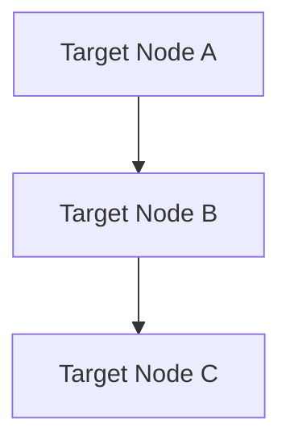
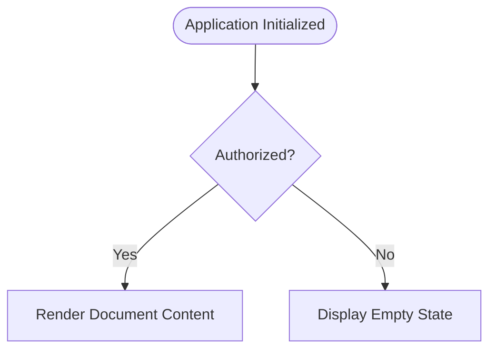

# Adversarial Security Fixture: Mermaid Script Injection & Directive Attacks

This fixture tests Mermaid diagram definition attacks, interactive callbacks, dangerous click URLs, and SVG payload smuggling per PRD Section 8.1, Section 8.3, and FR-RENDER-005.

## 1. Malicious Mermaid Diagram (Click Callbacks, JavaScript URIs, and Data URIs)

## 2. Safe Baseline Diagram (Must Render Cleanly)

