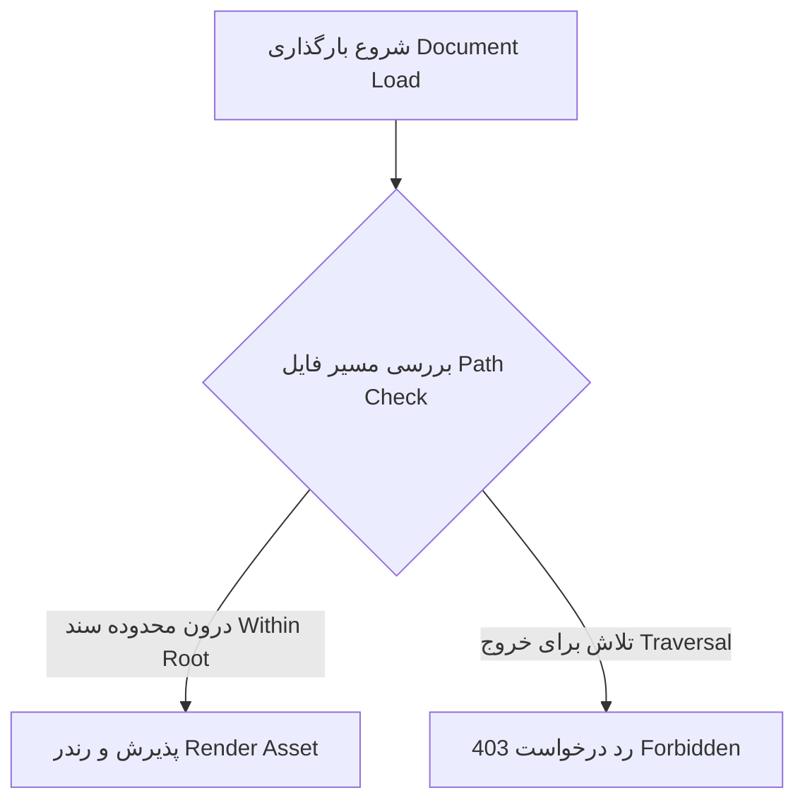

# سند آزمون جامع — سلام دنیا

این یک سند آزمون یکپارچه برای اعتبارسنجی قابلیت‌های رندرینگ، امنیت و پشتیبانی از دوجهته‌سازی متن (RTL/LTR) در چارچوب فنی برنامه است.

---

## ۱. متن راست‌به‌چپ (Persian RTL)

متن‌های فارسی باید به صورت راست‌به‌چپ (RTL) نمایش داده شوند و کلمات انگلیسی تعبیه‌شده در میان متن، مانند Markdown Viewer و Wails v3، بدون برهم‌ریختگی ترتیب کلمات در کنار هم قرار گیرند.

- مورد اول: بررسی هم‌ترازی راست‌چین متن
- مورد دوم: نمایش صحیح علائم نگارشی نظیر نقطه. و علامت سؤال؟
- مورد سوم: پیوندهای محلی و استنادها

---

## 2. English LTR Section

This section verifies Left-to-Right layout rendering, typography scale, code spans such as `ScopedResolver`, and standard Markdown blockquotes:

> Markdown Viewer is designed to be local-first, highly performant, and secure by default.

---

## ۳. فرمول‌های ریاضی (KaTeX Math)

فرمول‌های ریاضی باید به صورت شفاف و صحیح در میان خطوط و در بلوک‌های جداگانه رندر شوند:

- رابطه هم‌ارزی جرم و انرژی: $E = mc^2$
- فرمول انتگرال فوریه:

$$f(x) = \int_{-\infty}^\infty \hat{f}(\xi)\,e^{2 \pi i \xi x}\,d\xi$$

---

## ۴. نمودار فلوچارت (Mermaid Diagram)

نمودارهای تعاملی Mermaid باید در بوم یا ساختار SVG داخلی پنجره ترسیم شوند:



---

## ۵. بلوک‌های کد با نشانه‌گذاری زبان (Code Fences)

کدهای برنامه‌نویسی باید در قالب بلوک‌های مجزا و با قلم تک‌فاصله (Monospace) نمایش داده شوند:

```go
package main

import "fmt"

func main() {
    // چاپ پیام خوش‌آمدگویی
    fmt.Println("سلام دنیا — Hello World from Go!")
}
```

```typescript
export interface DocumentState {
    filePath: string;
    direction: "rtl" | "ltr";
    activeTab: number;
}
```

---

## ۶. تصویر محلی نسبی (Relative Local Image)

تصویر زیر از مسیر نسبی محلی در کنار سند فراخوانی می‌شود:


---

## ۷. آزمون خنثی‌سازی اسکریپت و کدهای مخرب (Security Sanitization)

کدهای اسکریپت تزریق‌شده زیر نباید تحت هیچ شرایطی در محیط کاربری اجرا شوند و باید به عنوان متن ساده رندر شده یا از درخت DOM حذف گردند:

<script>alert("XSS-ATTEMPT-VULNERABILITY");</script>


<div class="safe-html-block">
    <p><strong>این یک بلوک HTML ایمن است که بدون اسکریپت فعال رندر می‌شود.</strong></p>
</div>
